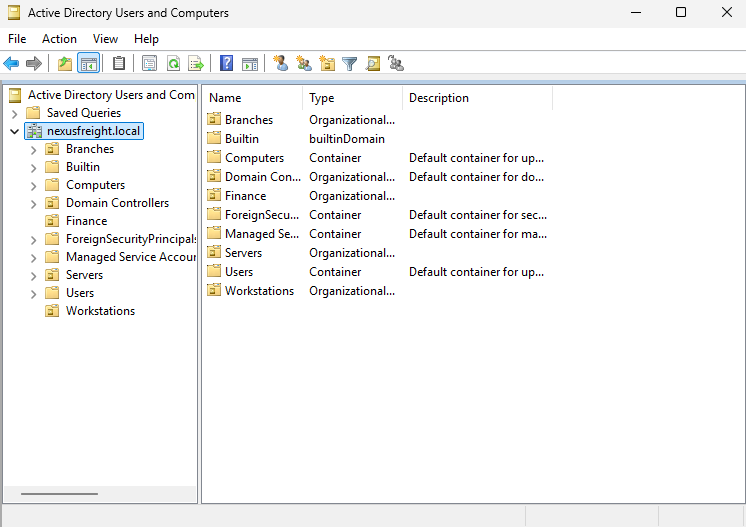
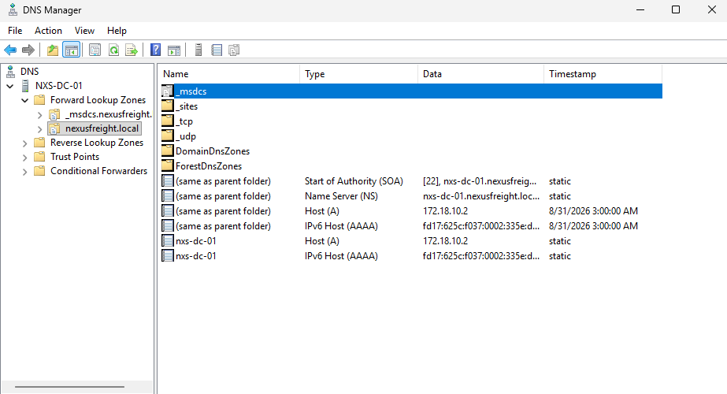
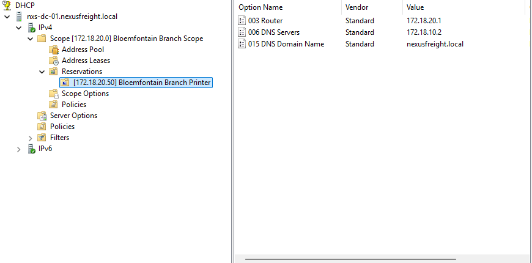
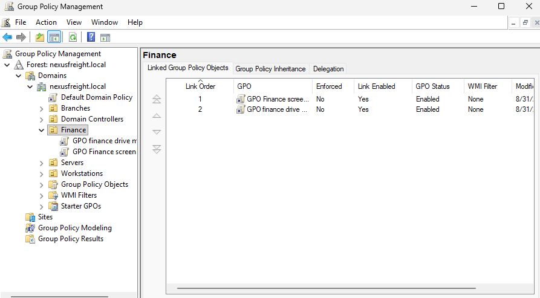
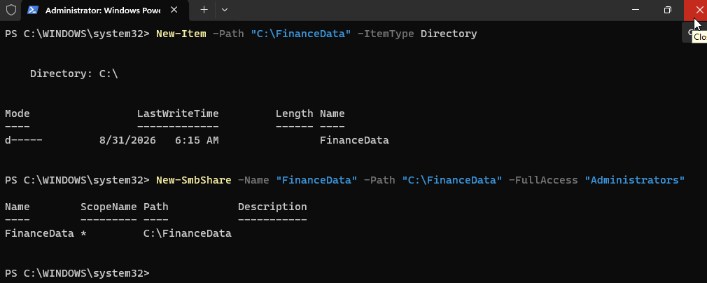
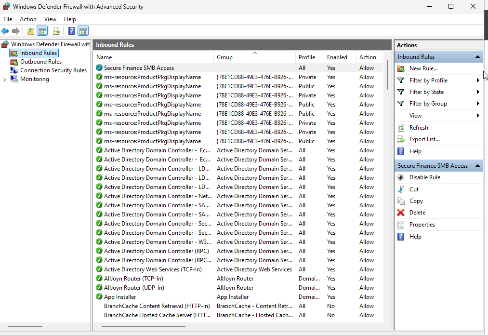

# windows-server-infrastructure-lab

# Multi-Site Windows Server Infrastructure Lab (`nexusfreight.local`)

A virtualized enterprise Windows Server infrastructure design and lab implementation for **Nexus Freight & Logistics**, a multi-site organization operating across Gqeberha (HQ), Bloemfontein, and Polokwane.

## Lab Architecture & Implementation

### 1. Active Directory & DNS (`nexusfreight.local`)
- Promoted `NXS-DC-01` (`172.18.10.2`) to a Domain Controller with an AD-integrated Forward Lookup DNS zone.
- Structured Organizational Units (`Branches`, `Finance`, `Servers`, `Workstations`) and security groups for role-based access control.

### 2. Branch DHCP Configuration
- Configured a DHCP scope (`172.18.20.0/24`) for the Bloemfontein branch with router/DNS scope options and a static reservation (`172.18.20.50`) for the shared branch printer.

### 3. Group Policy & Domain Client Integration
- Linked custom Group Policy Objects (`GPO Finance screen`, `GPO finance drive map`) to enforce security and automate network drive mappings on domain-joined workstations (`client1.nexusfreight.local`).

### 4. PowerShell Automation & Security Hardening
- Provisioned restricted Finance file shares (`C:\FinanceData`) via PowerShell (`New-Item`, `New-SmbShare`).
- Enforced a 12-character Fine-Grained Password Policy (`FinancePSO`) for Finance users and configured a scoped inbound Windows Defender Firewall rule (`Secure Finance SMB Access`).

